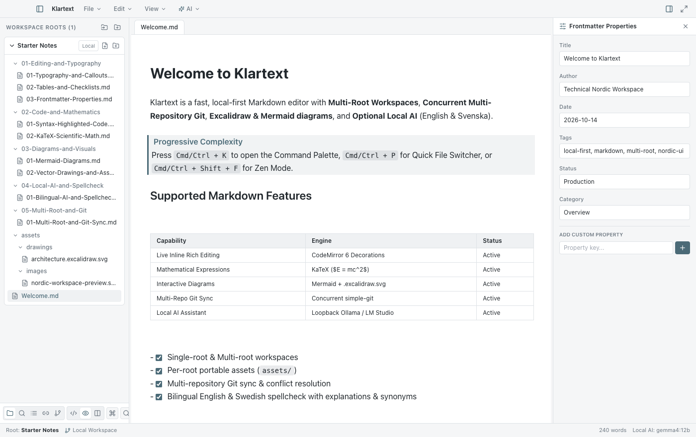
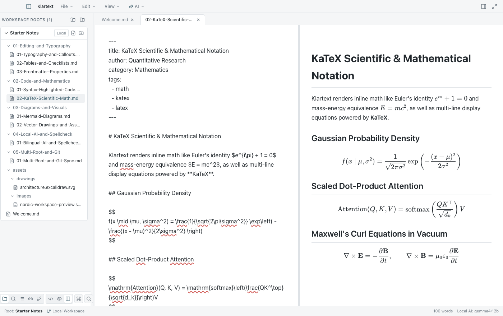
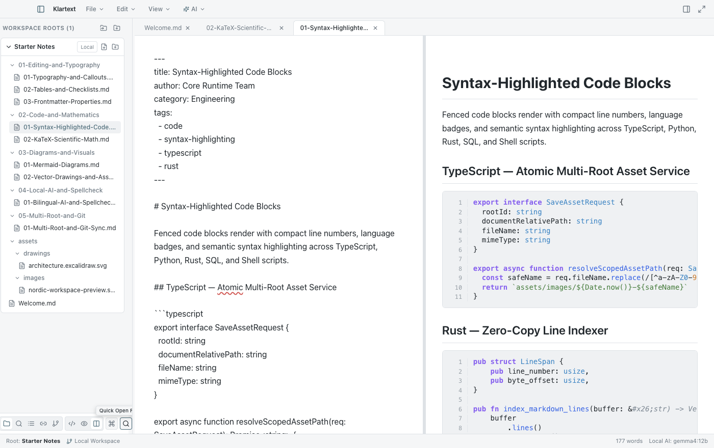
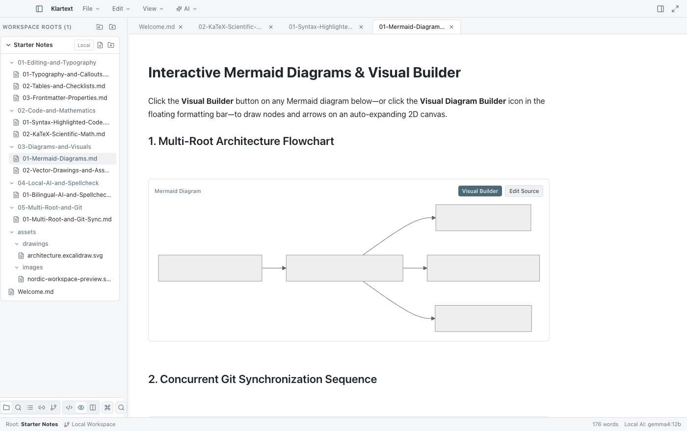
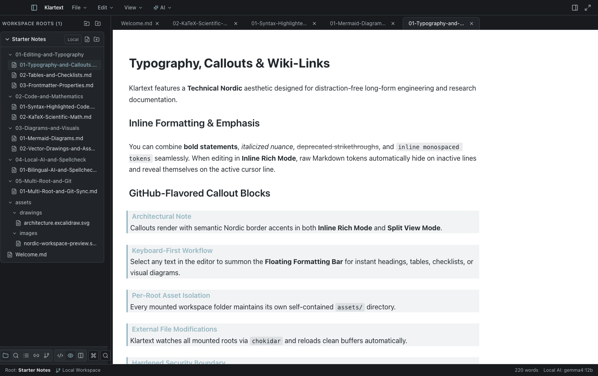
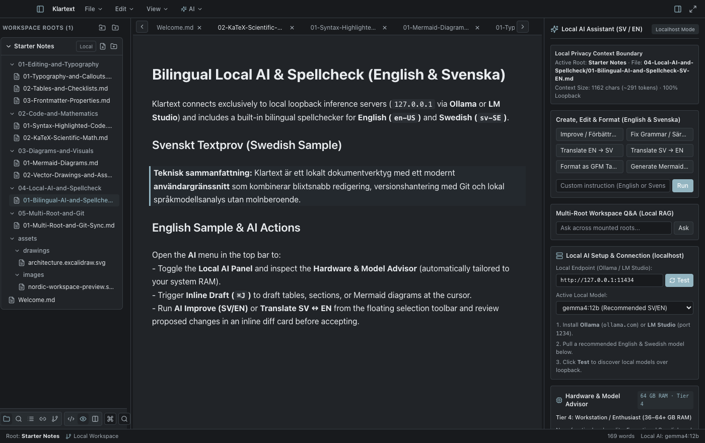

# Klartext

**Klartext** is a fast, local-first, cross-platform Markdown editor for macOS, Windows, and Linux. It combines a single-buffer **CodeMirror 6** editing engine (**Source**, **Live Inline Rich**, and **Split View** modes), interactive **Mermaid** and **Excalidraw (`.excalidraw.svg`)** diagrams, **Multi-Root Workspaces** with strict per-root asset portability, **Concurrent Multi-Repository Git synchronization**, and an optional **Local AI Assistant** (`127.0.0.1` via Ollama or LM Studio) with a built-in **Hardware & Model Advisor** for English and Swedish.



---

## Screenshots & Feature Tour

### 1. Live Inline Rich Mode, Multi-Root Explorer & Frontmatter Inspector
Edit Markdown directly in a live preview buffer where syntax tokens automatically hide on inactive lines and reveal on the active cursor line. Inspect and edit YAML metadata in the resizable right-hand **Frontmatter Properties** panel.


### 2. Split View Mode & KaTeX Scientific Mathematics
Work side-by-side with synchronized scrolling between your raw CodeMirror 6 source buffer and a sanitized live preview featuring inline and display **KaTeX** equations ($E = mc^2$, Gaussian distributions, Maxwell's equations, and matrices).



### 3. Syntax-Highlighted Code Blocks with Line Numbers
Fenced code blocks render with compact row numbers, language badges, and Technical Nordic syntax highlighting across TypeScript, Rust, Python, SQL, Bash, and JSON.



### 4. Interactive Mermaid Diagrams & Visual Diagram Builder
Render Flowcharts, Sequence Diagrams, and State Diagrams inline. Click **Visual Builder** on any Mermaid block—or open the **Visual Diagram Builder** from the floating formatting bar—to draw shapes and arrows on an auto-expanding, resizable 2D canvas that generates clean Mermaid syntax automatically.



### 5. Dark Mode with Optional White Paper Canvas & Callout Blocks
Switch seamlessly between Light and Dark themes, and optionally enable **White Paper Background in Dark Mode** (`View → White Paper Background in Dark Mode`) to keep the surrounding UI chrome dark while writing on a crisp light sheet.



### 6. Bilingual Local AI Assistant & Hardware Model Advisor (English & Svenska)
Connect strictly over loopback (`127.0.0.1`) to **Ollama** or **LM Studio** with zero cloud dependencies. The built-in **Hardware & Model Advisor** inspects system RAM and recommends vetted English & Swedish models (`gemma4:12b`, `qwen3:8b`, `mistral-small:24b`, `gemma4:26b`, `bge-m3`), paired with bilingual spellcheck (`en-US`, `sv-SE`, `de-DE`, `es-ES`, `fr-FR`) offering word explanations and synonyms.



---

## Showcase Markdown File Structure (`showcase/`)

Klartext includes a structured [`showcase/`](showcase/) workspace (also automatically seeded into your default `Starter-Workspace` on first launch) demonstrating all major capabilities:

```text
showcase/
├── Welcome.md
├── 01-Editing-and-Typography/
│   ├── 01-Typography-and-Callouts.md      # Headings, formatting, GitHub Callouts & Wiki-links
│   ├── 02-Tables-and-Checklists.md        # Interactive GFM tables & clickable task checkboxes
│   └── 03-Frontmatter-Properties.md       # Two-way synced YAML Frontmatter metadata
├── 02-Code-and-Mathematics/
│   ├── 01-Syntax-Highlighted-Code.md      # TypeScript, Rust, and Python code blocks with line numbers
│   └── 02-KaTeX-Scientific-Math.md        # Inline & block KaTeX mathematical equations
├── 03-Diagrams-and-Visuals/
│   ├── 01-Mermaid-Diagrams.md             # Flowcharts, Sequence, and State diagrams + Visual Builder
│   └── 02-Vector-Drawings-and-Assets.md   # Embedded .excalidraw.svg & per-root SVG assets
├── 04-Local-AI-and-Spellcheck/
│   └── 01-Bilingual-AI-and-Spellcheck-SV-EN.md # English & Svenska AI actions & spellcheck playground
├── 05-Multi-Root-and-Git/
│   └── 01-Multi-Root-and-Git-Sync.md      # Multi-root manifests, asset migration & Git conflict lenses
└── assets/
    ├── drawings/
    │   └── architecture.excalidraw.svg    # Portable vector diagram with embedded scene metadata
    └── images/
        └── nordic-workspace-preview.svg   # Vector preview asset scoped to the root folder
```

---

## Key Architectural Highlights

1. **Technical Nordic UI & Persistent Layout State:**
   - Frameless native window chrome with draggable titlebar regions, configurable page tab placement (above the editor or inline on the top menu row), and horizontal tab overflow scroll controls (`<` `>`).
   - Automatically remembers window position, size, maximized/fullscreen state, open tabs, active tab, sidebar widths, Split View divider ratio, and all view/typography settings across restarts.
2. **Multi-Root Workspaces & Per-Root Asset Scoping:**
   - Mount multiple folders into a unified workspace and save portable `.klartext-workspace` manifests.
   - Pasted or dropped images and `.excalidraw.svg` drawings are saved strictly inside the active document's owning root (`<ActiveRoot>/assets/`).
   - Moving a Markdown file across roots automatically detects referenced local assets and offers to migrate them and rewrite relative links.
3. **Concurrent Multi-Repository Git & Isolated Conflict Resolution:**
   - Independent `GitRepoInstance` controllers per root folder with per-repo mutexes and `core.hooksPath=/dev/null` hardening.
   - **Sync All Repositories** runs `fetch -> pull -> push` concurrently across all mounted Git repositories (`Promise.allSettled`), with inline conflict resolution lenses (`Accept Current`, `Accept Incoming`, `Accept Both`).

---

## Development & Packaging Commands

```bash
# Install dependencies
npm install

# Start Electron development mode with hot reload
npm run dev

# Run TypeScript typechecking & ESLint
npm run typecheck
npm run lint

# Run Vitest unit, security, and integration test suites
npm test

# Build production Main, Preload, and Renderer bundles
npm run build

# Run Playwright Electron End-to-End tests
npm run test:e2e

# Package & code-sign desktop application bundle
npm run package
```

---

## Documentation Index

- [Architecture Overview](docs/architecture.md)
- [Security & Threat Model](docs/security.md)
- [Markdown Compatibility Matrix](docs/markdown-compatibility.md)
- [Local AI Setup & Swedish/English Model Guide](docs/local-ai-guide.md)
- [Testing & Verification Guide](docs/testing.md)
- [Release & Packaging Process](docs/release-process.md)
- [Changelog](CHANGELOG.md)

---

## License

Released under the [MIT License](LICENSE).
