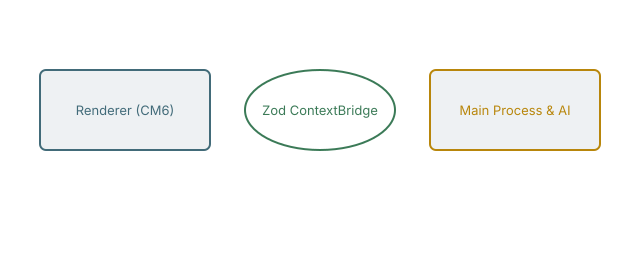
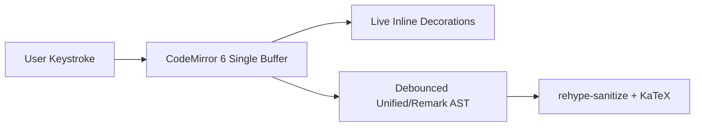
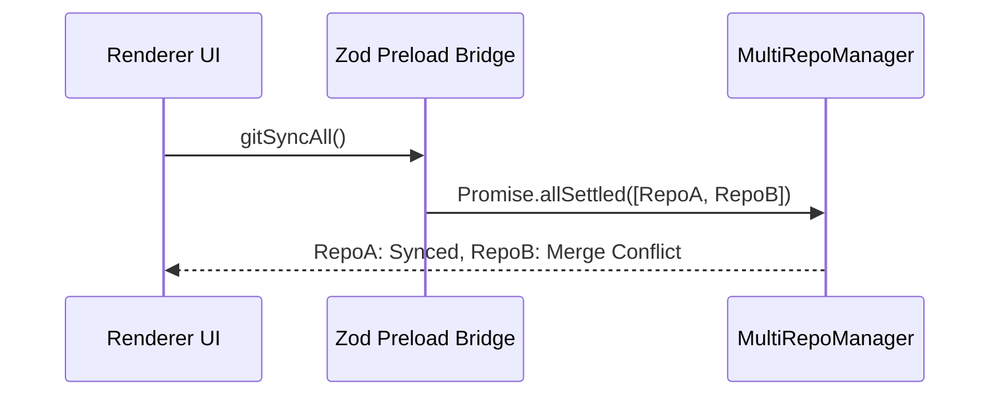

# 04. Interactive Mermaid & Excalidraw Diagrams

Klartext treats diagrams as first-class editable objects. In **Inline Rich** or **Split** mode, you can edit the Mermaid source directly from the widget header or click **Edit Drawing (`.excalidraw.svg`)** below! Links to [[02-Tables-and-TaskLists]].

## 1. Embedded Portable Excalidraw Drawing (`.excalidraw.svg`)

Click the **Edit Drawing (`.excalidraw.svg`)** button on the card below (or **+ Excalidraw** in the toolbar) to open the interactive vector canvas, add/edit shapes, and save back to `assets/drawings/architecture.excalidraw.svg`:

---

## 2. Mermaid Flowchart

## 3. Mermaid Sequence Diagram (Multi-Repo Sync)

