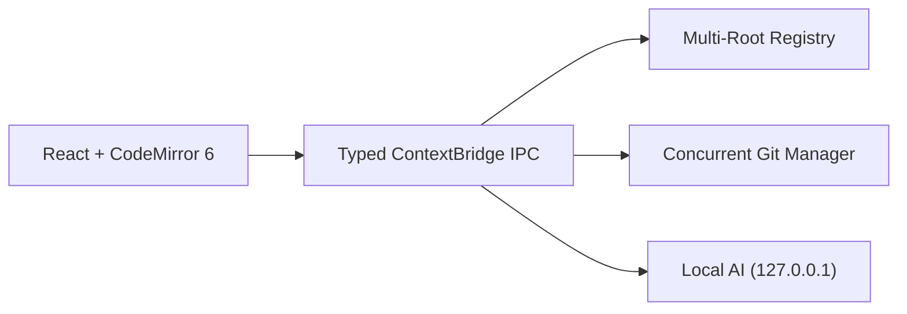
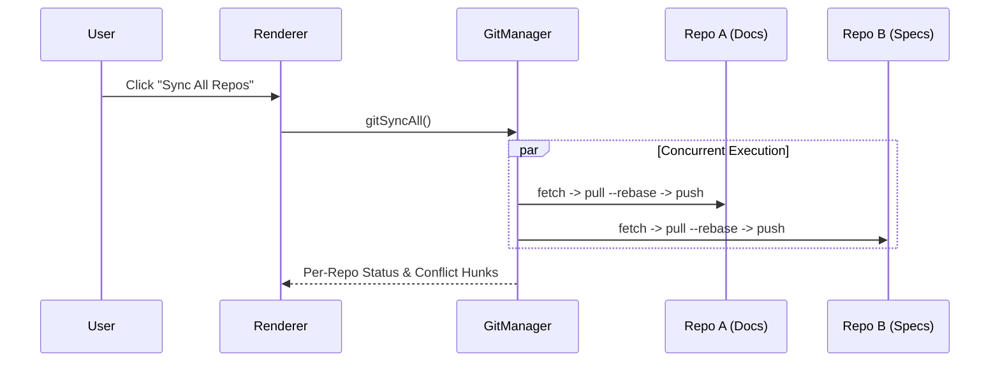
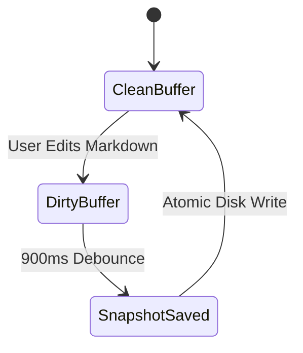

# Interactive Mermaid Diagrams & Visual Builder

Click the **Visual Builder** button on any Mermaid diagram below—or click the **Visual Diagram Builder** icon in the floating formatting bar—to draw nodes and arrows on an auto-expanding 2D canvas.

## 1. Multi-Root Architecture Flowchart

## 2. Concurrent Git Synchronization Sequence

## 3. Document Lifecycle State Diagram

