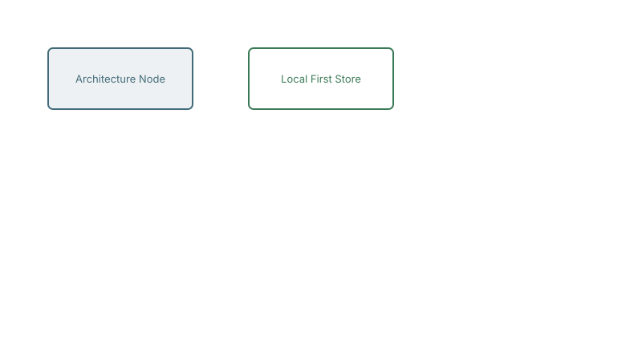
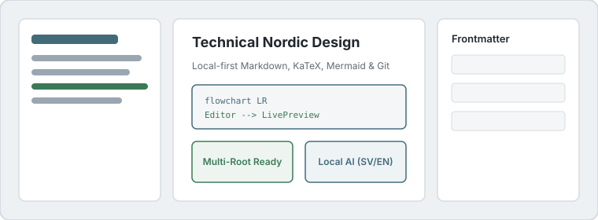

# Excalidraw Vector Drawings & Per-Root Assets

Klartext stores pasted images and interactive `.excalidraw.svg` vector drawings strictly inside the active root's `assets/` folder.

## Embedded Interactive `.excalidraw.svg` Drawing

Click **Edit in Excalidraw Studio** on the card below (or click the file in `assets/drawings/architecture.excalidraw.svg` in the sidebar) to open the vector studio:

## Local SVG Illustration in `assets/images/`

You can also view any image directly from the `assets/images/` folder in the left sidebar or embed it in Markdown:

