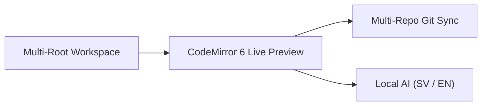

# Welcome to Klartext

Klartext is a fast, local-first Markdown editor with **Multi-Root Workspaces**, **Concurrent Multi-Repository Git**, **Excalidraw & Mermaid diagrams**, and **Optional Local AI** (English & Svenska).

> [!TIP] Progressive Complexity
> Press `Cmd/Ctrl + K` to open the Command Palette, `Cmd/Ctrl + P` for Quick File Switcher, or `Cmd/Ctrl + Shift + F` for Zen Mode.

## Supported Markdown Features

| Capability | Engine | Status |
| :--- | :--- | :--- |
| Live Inline Rich Editing | CodeMirror 6 Decorations | Active |
| Mathematical Expressions | KaTeX ($E = mc^2$) | Active |
| Interactive Diagrams | Mermaid + `.excalidraw.svg` | Active |
| Multi-Repo Git Sync | Concurrent `simple-git` | Active |
| Local AI Assistant | Loopback Ollama / LM Studio | Active |

- [x] Single-root & Multi-root workspaces
- [x] Per-root portable assets (`assets/`)
- [x] Multi-repository Git sync & conflict resolution
- [x] Bilingual English & Swedish spellcheck with explanations & synonyms

## Explore the Showcase Folders

1. **01-Editing-and-Typography** — [[01-Typography-and-Callouts]], [[02-Tables-and-Checklists]], [[03-Frontmatter-Properties]]
2. **02-Code-and-Mathematics** — [[01-Syntax-Highlighted-Code]], [[02-KaTeX-Scientific-Math]]
3. **03-Diagrams-and-Visuals** — [[01-Mermaid-Diagrams]], [[02-Vector-Drawings-and-Assets]]
4. **04-Local-AI-and-Spellcheck** — [[01-Bilingual-AI-and-Spellcheck-SV-EN]]
5. **05-Multi-Root-and-Git** — [[01-Multi-Root-and-Git-Sync]]
